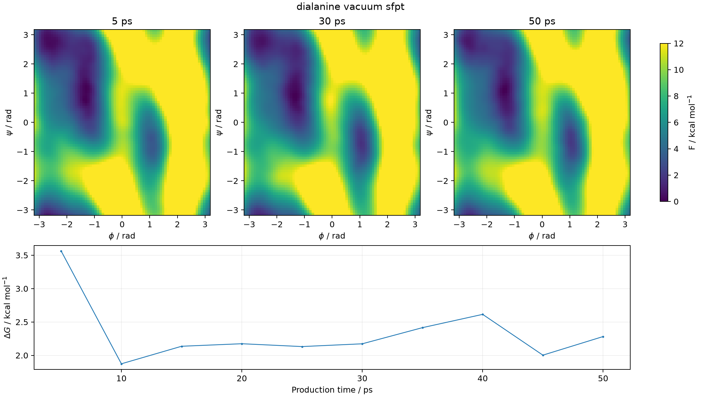

# sFPT paper experiments

Inputs, protocols, sampling scripts and FES data for the subspace Fokker–Planck Transformer paper. This repository supplies the molecular force fields, topologies, initial structures and ensembles needed to run the experiments with both sFPT and well-tempered metadynamics. The sampling library is maintained in [fp_transformer_torch](https://github.com/SunZichen-2004/fp_transformer_torch).

## What is included

| System | Molecular inputs | sFPT replicas / lambda | WT-MetaD walkers / hill height | Production per replica: sFPT / WT-MetaD |
| --- | --- | --- | --- | --- |
| Dialanine, vacuum | Amber parameter tables, structure, CV definitions and replica-specific initial pools | 256 / 0.1 | 256 / 0.005 eV | 50 ps / 50 ps |
| Dialanine, water | Explicit TIP3P box, MM topology, CV definitions and initial ensemble | 320 / 0.0625 | 320 / 0.004 eV | 200 ps / 200 ps |
| Tetra-alanine, vacuum | Amber parameter tables, structure, three torsions and prepared initial ensembles | 2048 / 0.075 | 64 / 0.02 eV | 500 ps / 10 ns |
| Claisen rearrangement, water | Reacting solute, explicit TIP3P box, MM/ML partition, topology and distance CVs | 512 / 0.025 | 64 / 0.02 eV | 83 ps / 400 ps |

[The protocol guide](docs/protocols.md) specifies preparation, healing, seeds, integration, PME, metadynamics settings, initial-pool selection and FES windows. [protocols/paper.json](protocols/paper.json) contains the runnable parameters. [input_checksums.json](input_checksums.json) identifies every supplied molecular input.

## Install

```bash
git clone https://github.com/SunZichen-2004/sFPT-paper.git
git clone https://github.com/SunZichen-2004/fp_transformer_torch.git
cd fp_transformer_torch
git checkout 7b9ba3f
pip install -e ".[simulation,mlip,analysis]"
cd ../sFPT-paper
pip install -r requirements.txt
python check_inputs.py
```

Use a CUDA-enabled PyTorch installation for production dynamics. [environment-tested.json](environment-tested.json) records the tested package versions. The bundled-data plots do not require a GPU; `fes_time.py plot` reads the bundled numerical data directly.

The reaction uses the **MACE-MH-0, omol head** model. Download and verify its exact upstream checkpoint with:

```bash
python download_model.py
```

The model is placed in the sampling library's cache; its URL, size and SHA-256 are in [model_checksums.json](model_checksums.json). Reaction protocols enable cuEquivariance. Install `mace-torch[cueq]` and the cuEquivariance operations package matching your PyTorch CUDA version; the tested CUDA 13 setup uses `cuequivariance-ops-torch-cu13`. CUDA 12 installations use the corresponding `cu12` package.

## Run the experiments

The default protocol uses the full paper production lengths above. For example:

```bash
python run_case.py dialanine_vacuum_sfpt --seed 0
python run_case.py dialanine_water_metad --seed 0
python run_case.py tetra_alanine_sfpt --seed 0
python run_case.py rearrangement_metad --seed 0
```

The eight case names are the four systems `dialanine_vacuum`, `dialanine_water`, `tetra_alanine` and `rearrangement`, each ending in `_sfpt` or `_metad`. `--dry-run` prints the resolved command and production time. See the protocol guide for each method's seed list. Runs are saved under `results/paper/CASE/seed_N/`.

A Slurm template is provided; adjust its resource directives for your cluster:

```bash
sbatch --export=ALL,CASE=dialanine_water_sfpt,SEED=0 cluster/submit.slurm
```

Replica and lambda scans use the same force fields and runners. `--replicas`, `--production-lambda`, `--hill-height`, `--seed`, `--steps` and `--init-npy` select the variants listed in [protocols/scans.json](protocols/scans.json). Prepared tetra-alanine pools for 1024–8192 replicas and vacuum dipeptide pools for 64–2048 replicas are included. Custom initial files require an explicit `--output` directory.

## FES versus time

[data/](data/README.md) contains **23 per-seed FES time series** for all four systems and both methods, together with the numerical source caches for the paper and SI replica/lambda scans. These include full FES arrays, time axes, angular/distance grids, basin differences and reconstruction metadata. The original stored time points and numerical precision are retained.

```bash
python fes_time.py verify
python fes_time.py plot --case dialanine_vacuum_sfpt --seed 0
python fes_time.py plot --case tetra_alanine_metad --seed 0 --times 20 100 500
```

The time-series plots combine FES snapshots and the full basin-population curve. [data/catalog.json](data/catalog.json) records file checksums, per-seed coverage and source locations. Source caches retain their native field names; the main time series share the schema described in [data/README.md](data/README.md).

For a newly generated trajectory, reconstruct the FES at successive times with:

```bash
python fes_time.py reconstruct --case dialanine_vacuum_sfpt \
  --trajectory results/paper/dialanine_vacuum_sfpt/seed_0/trajectory.npz \
  --output analysis/dialanine_vacuum_sfpt_seed0.npz --device cuda
python fes_time.py plot --input analysis/dialanine_vacuum_sfpt_seed0.npz \
  --output analysis/dialanine_vacuum_sfpt_seed0.png
```

## Trajectories and postprocessing

Each run writes one complete `trajectory.npz` containing full coordinates, CVs, explicit time/replica axes, sFPT bandwidths and lambda, metadata and a completeness flag. WT-MetaD also stores the deposited hills and final bias grid. Preparation and production times are separate. The fixed production lambda follows the prescribed healing stages.

A local `checkpoint.pt` saves the simulation and RNG states once per ps. Repeat the same command to continue an interrupted calculation; the temporary checkpoint is removed after the complete NPZ is saved. Resume only checkpoints produced in your own run directory.

The reaction structural postprocessor exports substrate, transition-region and product configurations, PDBs, a PyMOL script and a schematic:

```bash
python experiments/rearrangement_water_fpt/extract_reaction_pdb.py \
  --trajectory results/paper/rearrangement_sfpt/seed_0/trajectory.npz
```

The core library also retains the neural maximum-likelihood FES fitter. Both KDE and WT-MetaD reconstruction form the physical joint probability before marginalization.

## Example output



[Example results and figures](reports/README.md) are included. To run the shorter example configuration, use `--protocol example`; `--steps 100 --output smoke/CASE` provides a small dynamics check.
